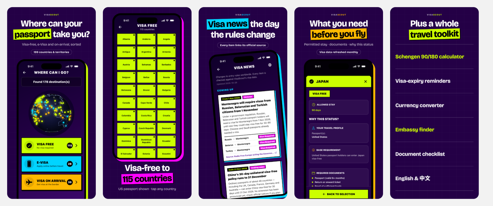
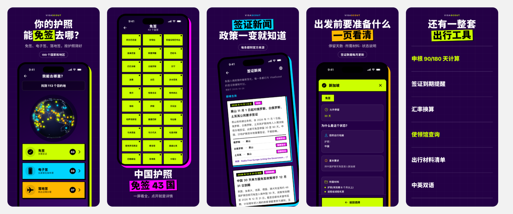

# shotline

App Store screenshots as a pipeline: **capture** real screens from the simulator,
**compose** them with copy into store-size slides, **check** them against hard gates,
**ship** them to App Store Connect and **verify** they arrived.

One JSON file per app. No design tool, no UI-test target, no app changes.

[中文说明](README.zh-CN.md) · [The method](docs/METHOD.md)




*The [VisaScout](examples/visascout/shotline.json) set: 2 locales × iPhone + iPad,
20 PNGs, captured, rendered, uploaded and verified by the commands below.*

## Why

Screenshot tooling usually solves one step: a renderer, or a framing tool, or an
uploader. The failures we hit shipping real apps sat between the steps — a headline
that shrank until it was unreadable, a number that no longer matched the screen, an
iPad set that was a phone screenshot, an upload that returned 200 and then failed
processing. shotline puts each step behind a gate and writes the rules down in
[docs/METHOD.md](docs/METHOD.md).

## Requirements

- macOS with Xcode (simulators, `xcrun simctl`)
- Google Chrome (headless rendering)
- Python 3.10+, standard library only
- [AXe](https://github.com/cameroncooke/AXe) — only if your capture steps tap or swipe
- An App Store Connect API key — only for `ship` / `verify` / `submit`

## Install

```bash
pip install git+https://github.com/Hellotravisss/shotline
```

## Use

```bash
shotline capture -c shotline.json            # simulators → raw/
shotline compose -c shotline.json            # raw/ + copy → out/
shotline check   -c shotline.json            # gates + out/sheet-*.png
shotline ship    -c shotline.json --version 1.4.0      # upload + verify
shotline submit  -c shotline.json --version 1.4.0      # App Review, only if verify passes
```

Every command takes `--locale` and `--device` to narrow the run; `capture` also takes
`--shot`.

App Store Connect credentials come from the environment only:

```bash
export ASC_KEY_ID=XXXXXXXXXX
export ASC_ISSUER_ID=xxxxxxxx-xxxx-xxxx-xxxx-xxxxxxxxxxxx
export ASC_KEY_PATH=~/.appstoreconnect/private_keys/AuthKey_XXXXXXXXXX.p8
```

## shotline.json

```jsonc
{
  "ascAppId": "1234567890",
  "ascLocales": {"zh": "zh-Hans", "en": "en-US"},   // shotline locale → ASC locale
  "locales": ["zh", "en"],
  "devices": ["iphone", "ipad"],                   // 1290×2796 and 2064×2752
  "theme": {"preset": "brutal"},                    // or "editorial"; override any token
  "eyebrow": "APP*NAME*",                           // small brand line above every headline

  "slides": [
    {
      "layout": "hero",                             // hero | device-top | tilted | wall | mosaic
      "shot": "explore",                            // raw/<locale>-<device>-explore.png
      "headline": {"en": "Where can your\n*passport* take you?", "zh": "…"},
      "sub":   {"en": "Visa-free, e-Visa and on-arrival, sorted", "zh": "…"},
      "trust": {"en": "199 countries & territories", "zh": "…"}
    },
    {"layout": "wall", "headline": {"en": "Plus a whole\n*travel toolkit*"},
     "items": {"en": ["Schengen 90/180 calculator", "Currency converter"]}}
  ],

  "capture": {
    "bundleId": "com.example.app",
    "simulators": {"iphone": "iPhone 17 Pro", "ipad": "iPad Pro 13-inch (M5)"},
    "vars": {"en": {"lang": "en", "passport": "United%20States"}},
    "setup": [{"mergeJson": {"file": "Library/Application Support/{bundle}/RCTAsyncLocalStorage_V1/manifest.json",
                             "set": {"@app_language": "{lang}"}}}],
    "shots": {
      "explore": [{"open": "myapp://results?passport={passport}"}],
      "check":   [{"open": "myapp://results?passport={passport}"},
                  {"tap": {"iphone": [201, 530], "ipad": [516, 517]}, "settle": 3}]
    }
  }
}
```

- `\n` breaks a headline line; `*word*` is the emphasised word.
- Copy fields are a string or `{locale: string}`.
- `"logo": "path.png"` on a slide puts the app's logo, unaltered, on a plate above the
  headline (theme token `logoPlate`) — the cover.
- Capture steps: `open`, `tap`, `swipe`, `wait`, `launch`, `mergeJson`, `defaults` —
  any step takes `"device": "iphone"` to run on one device only, and coordinates can be
  given per device and locale (`"ipad@fr"`) —
  documented in [shotline/capture.py](shotline/capture.py).
- `rawDir` / `outDir` default to `raw/` and `out/` next to the JSON. Commit `raw/`.

## Layout

```
shotline/
  capture.py   simctl + AXe: boot, status bar, seed state, steps, screenshot
  compose.py   themes, copy → HTML → headless Chrome → PNG, fit/overflow report
  templates/slide.html
  check.py     size/overflow gates, review sheets
  asc.py       App Store Connect API (stdlib; ES256 via openssl)
  ship.py      replace sets, verify, submit
  devices.py   canvas sizes and frame geometry
```

## License

MIT
